<!-- Tema corporativo "Rede & IA" · telecomunicações, IoT e inteligência artificial -->
<!-- Antes de publicar: troque SEU_USUARIO, SEU_LINKEDIN e SEU_SITE (Ctrl+H). -->

  

  

  
  
  

 

  

ÁREAS DE ATUAÇÃO

<h2 align="center">Perfil profissional</h2>

SOBRE

> **Luís Roberto Fernandes Pedro** 
> *Engenheiro Eletricista com especialização em Telecomunicações pelo Inatel.*

Tenho uma trajetória executiva como gerente de filiais e unidades de negócio, unindo infraestrutura robusta de telecomunicações (FTTH, backbones e redes de acesso) à inteligência de dados de IoT e telemetria. Lidero equipes multidisciplinares, integrando TI, produção, frota e RH, com foco em transformar conectividade em resultados: otimizar processos, gerir ativos e elevar indicadores de performance.

- **Atualmente:** Gerente Geral de Operação, Manutenção e Implantação · Tel Telecomunicações
- **Também:** Gerente de Serviços e Operações IoT · M2M · Telemetria
- **Formação:** Engenharia Elétrica · especialização em Telecomunicações pelo Inatel
- **Localização:** Rio de Janeiro, Brasil

DESTAQUES DA CARREIRA

- **Infraestrutura crítica:** construção e manutenção de redes de fibra óptica e arquitetura de redes complexas.
- **Inovação e IoT:** gestão de projetos de Internet das Coisas e Machine Learning para monitoramento e tomada de decisão.
- **Visão internacional:** dois anos de atuação profissional em Buenos Aires.
- **Excelência operacional:** metodologias de gestão e qualidade em contratos de grande porte e alta complexidade.

<h2 align="center">Competências</h2>

HABILIDADES, CURSOS E FERRAMENTAS

<!--
  COMO EDITAR AS COMPETÊNCIAS
  Cada habilidade é uma linha .
  · Para remover: apague a linha inteira.
  · Para adicionar: copie uma linha e troque o nome depois de /badge/ (use %20 no lugar de espaço).
    Para pôr um logo, acrescente &logo=NOME&logoColor=38BDF8 (nomes em https://simpleicons.org).
-->

TELECOMUNICAÇÕES E REDES

  
  
  
  
  

DADOS, IoT E INTELIGÊNCIA ARTIFICIAL

  
  
  
  
  
  
  

GESTÃO E QUALIDADE

  
  
  
  
  
  

<b>Cursos e especializações</b>

 

| Área | Cursos |
| :-- | :-- |
| **Gestão** | Gestão de Projetos · Gestão da Qualidade + Gestão de Projetos · Excelência em Gestão da Qualidade e Metodologia Lean Seis Sigma |
| **Ferramentas** | Microsoft Project · Jira Software: projetos completos com Scrum · Power BI · Excel Avançado |
| **Redes e telecom** | Arquitetura de Redes · Redes de Computadores · Tecnologia da Informação e Comunicação (TIC) · Fibra Óptica |
| **Dados e IA** | Aprendizagem de Máquina (ML) · Engenharia de Prompt: criando prompts eficazes para IA Generativa · Lógica de Programação |
| **Automação** | Automação de Fluxos com n8n |

LINGUAGENS MAIS USADAS NOS REPOSITÓRIOS

  

<h2 align="center">Indicadores</h2>

ESTATÍSTICAS NO GITHUB

  

  

<h2 align="center">Atividade</h2>

CONTRIBUIÇÕES

  

  

  <i>Transformando conectividade em resultados.</i>

